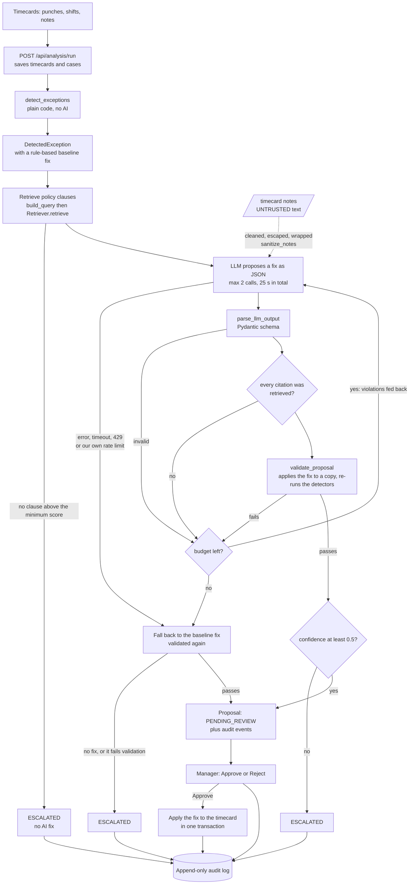

# Architecture

How a timecard problem is found, fixed on paper, checked, and shown to a manager, and where
each safety check sits. Written from the code on `main`, including the analysis endpoint, the
LLM rate guard, the metrics and the system tests (PR #19, merged).

## The idea in one paragraph

Plain code finds the problem. An AI model is asked to suggest a fix, and is only allowed to
answer in a fixed shape and to cite policy text we gave it. Plain code then checks that fix
against the rules. If the model fails or is wrong, we use the fix the rules themselves
produced, or hand the case to a person. Only a manager's approval changes a timecard, and every
step is written down. The model is one untrusted step inside a frame of ordinary code.

## The whole flow

`run_workflow` returns the proposal and the list of audit events. It stores nothing itself; the API
(`POST /api/cases/{id}/propose`) saves the proposal and the events, in one transaction.

## What each part does

| Part | Where | Job |
|---|---|---|
| Contracts | `backend/app/contracts/models.py`, `policy_config.py` | The shared data shapes (Pydantic) and the policy numbers. Everyone codes against these. |
| Policy text | `data/policies/time_attendance_policy.md` | The seven clauses `POL-TA-01` to `POL-TA-07`, split by heading into searchable chunks. |
| Detectors | `backend/app/domain/rules/detectors.py`, `analysis.py` | `detect_exceptions` finds missed punches, overtime risk, schedule conflicts and policy breaches. Pure functions. Never reads the notes. |
| Retrieval | `backend/app/ai/retrieval.py`, `embeddings.py`, `ingest.py` | `build_query` makes a search text for the rule that fired. `InMemoryRetriever` (keyword match) or `PgVectorRetriever` (embeddings, cosine similarity) return the matching clauses with a score. |
| Prompts | `backend/app/ai/prompts.py` | The system and user prompts, the shape the model must answer in (`LLMProposal`), and `sanitize_notes`. |
| Model client | `backend/app/ai/llm.py` | `OpenAICompatibleLLM` (any OpenAI-style endpoint, such as Groq) and `MockLLM` (a fake with failure modes, for tests). Model name, URL and key come from environment variables. |
| Workflow | `backend/app/ai/workflow.py` | `run_workflow` and `generate_proposal`: the state machine in the diagram. |
| Validator | `backend/app/validator/validator.py` | `validate_proposal`: re-checks every proposed fix with the real rules. |
| Settings | `backend/app/ai/settings.py` | Thresholds, retry budget (2 calls), deadline (25 s), `LLM_MAX_RPM`, `FALLBACK_CONFIDENCE`. All overridable by environment variables. |
| LLM guard | `backend/app/ai/guard.py` | `RateLimiter` (sliding window, moved from the smoke script), `RateLimitedLLM` (waits for a slot, or fails if the wait would pass the deadline so the workflow falls back), `InstrumentedLLM` (latency and error counts for `/metrics`). Applied in the API only. |
| Scripts | `backend/scripts/`, `scripts/` | `smoke_llm.py` (compare models), `evaluate.py`, `demo_flow.py` (narrated run), `export_mock_data.py`, `export_openapi.py`; at the repo root `load_test.py`, `demo_seed.sh`, `clean_clone_check.sh` (PRs #19 and #20). |
| API and database | `backend/app/api`, `db`, `main.py` | Cases, propose, approve, reject, audit, `/health`, `/metrics`, Postgres tables, append-only audit trigger (PR #12, merged). adds `POST /api/analysis/run`, `GET /api/timecards`, `GET /api/policies/search` and the AI safety metrics. |
| Frontend | `frontend/` | Manager screens, on built-in mock data or the real API (PRs #12 to #14, merged). |
| Evaluation | `backend/tests/golden`, `backend/scripts/evaluate.py` | A golden set of 40 cases and the script that writes `docs/evaluation_report.md` (PR #15, merged). |
| System test | `backend/tests/system/` | The real API as a separate process, over HTTP, against a pgvector database, with LLM failure injection. |

## Where each safety check sits

| Check | Where in the flow | What it stops |
|---|---|---|
| Deterministic detection | `detect_exceptions`, before any AI | The model deciding what is wrong. It only ever sees an exception that code found. |
| Typed answer | `parse_llm_output` (`LLMProposal`) | Free text. A reply must be valid JSON in a fixed shape, with a rationale of at most 400 characters and a confidence between 0 and 1. |
| Notes are data | `sanitize_notes` plus the system prompt | Instructions hidden in the employee's notes. Control characters are removed, `<` and `>` are escaped (so the notes cannot close their own tag), the text is cut to 500 characters and wrapped in `<untrusted_notes>`. |
| Grounded citations | citation check in `run_workflow` | Invented policy. Every cited clause id must be one that was retrieved above the minimum score, and at least one is required. Quotes on the final proposal are copied from the retrieved text, never from model output. |
| Rule validation | `validate_proposal` | A wrong fix. It checks the kind of fix, what it touches, the 12 hour limit, the 10 hour rest rule, the break deduction, whether the problem is really gone, and whether a new violation appears. |
| Retry budget and deadline | top of the LLM loop | A slow or looping model. At most 2 model calls and 25 seconds per proposal, whatever mix of failures happens. |
| Rate guard | `guard_llm` in the propose endpoint | Hammering a provider with a rate limit. Real calls wait for a slot under `LLM_MAX_RPM` (default 5 a minute, per process, so per replica); if the wait would pass the deadline the call fails and the workflow falls back. The mock is never limited. |
| Fallback | `fallback()` in `run_workflow` | A model that is down, rate limited, or wrong. The rule-based fix is used, and it is validated too. |
| Escalation | `escalate()` in `run_workflow` | Cases with no safe automatic answer. The result is a `FLAG_FOR_MANAGER` fix with no changes. Reasons: `NO_POLICY_MATCH`, `NO_BASELINE_FIX`, `BASELINE_FIX_INVALID`, `LOW_CONFIDENCE`. |
| Human decision | manager Approve or Reject endpoints | Any change without a person. Only an approval applies a fix, in one transaction with the decision and its audit events; an escalated case cannot be approved; a second approval is refused. |
| Audit trail | events from `run_workflow`, the analysis and decision endpoints | Hidden steps. Every step has an event. The table is append-only: a database trigger rejects updates and deletes (checked by the system test). |
| Demo reset endpoint | `require_dev_seed` | A wipe of all data. `POST /api/dev/seed` answers 404 unless `ENABLE_DEV_SEED=true`, and the check runs before the database is touched. |
| Metrics | `/metrics` | Silent failure. Counters for proposals by source, validator rejections, escalations by reason and LLM errors by kind, and a latency histogram for LLM calls. |

## The two retrievers

- **Memory** (`RETRIEVER=memory`, the default): scores a clause by the share of query words it
  contains. No database, no model download. Used by tests and CI. Minimum score 0.35.
- **pgvector** (`RETRIEVER=pgvector`): embeds the query with `BAAI/bge-small-en-v1.5`
  (fastembed, 384 numbers) and searches the `policy_chunks` table by cosine similarity. Minimum
  score 0.57, chosen from a measured table (see `docs/OVERVIEW.md`). Load the policy with
  `python -m app.ai.ingest`.

## What runs where today

- On `main`: the whole flow (detection, retrieval, model, checks, proposal), the API and database,
  approve and reject with the append-only audit trail, the frontend against the real API or on mock
  data, the golden set and evaluation, Docker Compose, Kubernetes manifests for Postgres and the
  frontend and backend (PR #21), and CI for the backend (ruff, pytest against a pgvector service) and
  the frontend.
- Also on `main` (PR #19): `POST /api/analysis/run` so real timecards go in and cases come out, the
  timecards list and policy search, the LLM rate guard, the new metrics, the system test and the
  load test. CI runs the database and system tests; the load test is local only (see
  [ci-additions.md](ci-additions.md)).
- Not built: the frontend `/api` proxy config in the image, a public deployment, login and roles.
